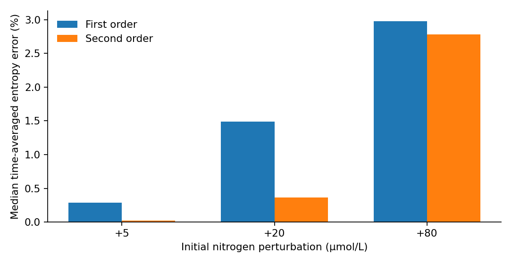
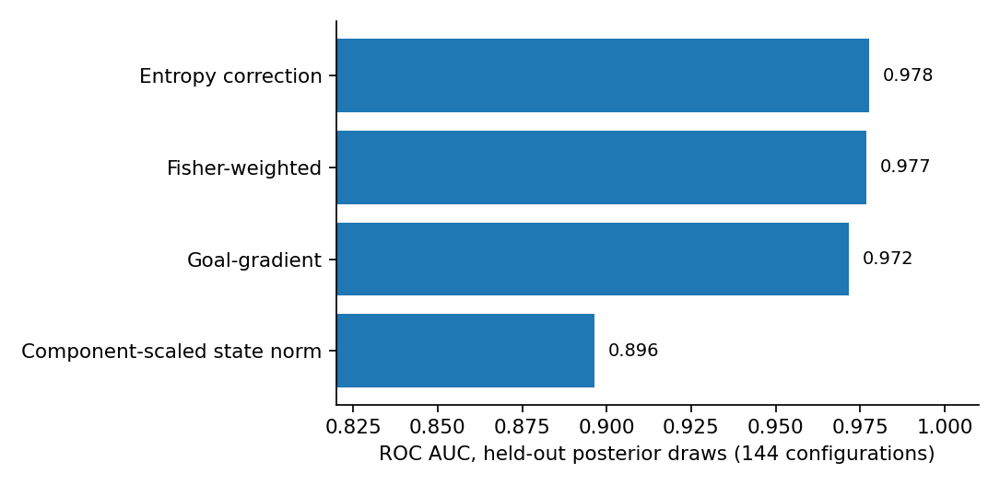

# Introduction

Finite-time reliability of a dynamical approximation and prediction of a measured ecological outcome are different questions. A first- or second-order expansion may approximate a nonlinear model internally without the underlying model forecasting experiments excluded from its fitting. A second ambiguity concerns the choice of diagnostic: a goal-specific indicator can easily outperform an unrelated state norm even when no unique goal-specific information is present. Goal-oriented a posteriori estimation and adjoint methods already address errors in chosen observables [@becker2001; @cao2004; @giles2002]. The relevant scientific question is therefore not whether entropy-aware diagnostics can outperform every possible state metric, but what remains when the comparator has equivalent model and geometric information.

We study a reproducible example based on the posterior-fitted ecological ordinary differential equations used by @wojcik2025. The paper's contribution is intentionally narrow: (a) reproduce the published posterior-predictive dynamics; (b) examine amplitude-dependent finite-time approximation errors; (c) compare multiple warning indicators under matched reference trajectories, Taylor information and calibration budgets; and (d) show the limit of transferring within-model reliability claims to actual held-out ecological data. We do not introduce a new Bregman identity, a novel adjoint method or a general validated certificate.

# Ecological system and numerical protocol

## Model and source of parameters

The source chemostat experiment comprises 24 vessels (12 monoculture and 12 polyculture cases). Let $N$ denote nitrogen concentration, $A$ algal biovolume, and $R$ rotifer biovolume. The recovered model is

$$
F_A=\frac{bNA}{K+N},\qquad F_R=\frac{aAR}{1+ahA},
$$

$$
\dot N=0.2(80-N)-F_A/e_A,\quad
\dot A=F_A-F_R-0.2A,\quad
\dot R=e_RF_R-(m+0.2)R.
$$

The model parameters and pre/post initial conditions are supplied by the authors' publicly archived Bayesian fit and converted into numeric draw tables. Post-pulse segments have separately fitted latent initial states; simulations here modify *fitted post-pulse initial nitrogen* rather than recreating the physical nutrient-pulse protocol. Posterior draws are not independent experiments.

Using a separate Python integrator, the source study's posterior-predictive quantiles were reproduced over 43,200 trajectory-quantile-component comparisons. The largest relative discrepancy was approximately 0.0645%, according to the archived reconstruction output. This validates implementation consistency against the study's published predictions, not independent biological forecast skill.

## Taylor approximations and observable

For each fitted parameter vector $\theta$ and positive reference $X(t)$, perturb the initial nitrogen by $\varepsilon e_N$. The first and second variations obey

$$
\dot u=J(X)u,\quad u(0)=e_N,\qquad
\dot w=J(X)w+\tfrac12D^2F(X)[u,u],\quad w(0)=0.
$$

The state predictions are $p_1=X+\varepsilon u$ and $p_2=p_1+\varepsilon^2 w$. We use a *weighted generalized abundance I-divergence*, not thermodynamic entropy or compositional KL divergence:

$$
D_\omega(z\mid X)=\sum_{i=1}^3 \frac{z_i\log(z_i/X_i)-z_i+X_i}{\omega_i},\qquad \omega_i=X_i(0)>0.
$$

With $h=p_2-p_1$, an exact Bregman decomposition is

$$
D_\omega(p_2\mid X)-D_\omega(p_1\mid X)
=\sum_i\frac{h_i}{\omega_i}\log\frac{p_{1,i}}{X_i}+D_\omega(p_2\mid p_1).
$$

This identity is standard Bregman geometry [@bregman1967; @banerjee2005]. It explains metric alignment, but is not our novel theorem. Positivity of $X,p_1,p_2$ is checked. All first- and second-order comparisons use identical reference and perturbation dynamics. The time-averaged error uses the exact perturbed model divergence as its within-model target, with near-zero divergence times excluded according to the archived numerical protocol.

# Results

## Approximation accuracy and perturbation amplitude

Eight posterior draws per treatment group were evaluated across all 24 vessel-specific fitted initial states. At each of $\varepsilon\in\{5,20,80\}$ µmol/L this gives 192 draw–vessel configurations, or 576 configurations in total. At perturbations +5, +20 and +80, median first-order divergence approximation errors were 0.287%, 1.492%, and 2.980%; second-order medians were 0.0213%, 0.362%, and 2.780%. Second-order error was smaller in 192, 191, and 139 of the 192 configurations, respectively. These comparisons concern within-model approximation, not held-out ecological prediction.

{fig-alt="Grouped bar chart of first- and second-order approximation error medians at perturbations 5, 20 and 80 micromoles per liter." width=90%}

## Equal-information warning comparison

For +20 µmol/L, an exploratory threshold design classifies a configuration as a first-order entropy-prediction failure when its time-averaged relative divergence error exceeds 1%. The choice of threshold and perturbation arose during earlier exploration; it was held fixed for the posterior-draw confirmation experiment but was **not preregistered for the entire study**. The discovery set contains 192 configurations and the confirmation set 144 *additional posterior-draw* configurations from the **same already fitted** posterior distribution. Logistic models apply logarithmic predictor transforms followed by standardization and regularized fitting, with the same discovery data and calibration settings per comparator. No confirmation labels are used in fitting the warning calibrators.

All methods use $X,u,w$ and the same temporal window. The entropy correction predictor measures the normalized magnitude of $D_\omega(p_2\mid X)-D_\omega(p_1\mid X)$. The Fisher-weighted state predictor takes a quadratic metric based on the positive reference/first-order prediction; a component-scaled norm provides the coarse state comparator. A goal-gradient feature uses the first term of the Bregman identity. Importantly, the *exact* goal-gradient plus curvature sum **equals** the entropy correction, and therefore must not be counted as a separate independent competitor. A two-feature regression on goal-gradient and curvature is a distinct *calibration architecture*, even though the underlying information is the same.

In 144 confirmation configurations, the entropy indicator yields ROC AUC 0.977709 and Brier score 0.068084. The Fisher-weighted indicator yields AUC 0.976934 and Brier 0.070118. The component-scaled state norm yields AUC 0.896492 and Brier 0.132038; the goal-gradient predictor yields AUC 0.971700 and Brier 0.076286. The entropy–Fisher AUC difference is only 0.000775; the exploratory chemostat-cluster resampling interval of the difference includes zero (about −0.016 to +0.020). AUC comparisons must not be taken as causal evidence that one error estimator contains intrinsically new information.

{fig-alt="Horizontal bar plot of AUC for entropy correction, Fisher-weighted correction, goal gradient and a component-scaled state norm." width=90%}

# Interpretation and external-validity limits

This comparison demonstrates a benchmark-design effect rather than a new mathematical identity: an apparently large benefit over an unweighted or component-scaled norm becomes negligible against a reference-informed Fisher-weighted diagnostic. A meaningful comparison must match access to reference trajectories, Taylor order, observable geometry, calibration examples and computational budgets. This is consistent with longstanding goal-oriented estimation and Bregman information geometry, rather than contradicting those approaches.

An exploratory chemostat-holdout forecasting analysis using separately refitted simplified mechanistic parameters did not beat a day-2 persistence forecast on observed algal and rotifer biomass (mean absolute natural-log errors approximately 0.895 versus 0.746 for the 23 matched valid vessels under one latent-nitrogen strategy). This negative result is supplementary: the original Stan model was not refitted under the exact same holdout setup, nutrient concentrations were unobserved and one model run failed. It should not be read as a refutation of the published ecological model.

Independent validated numerical certification of a continuous latent-state uncertainty set remains outside the results reported here. Preliminary residual-coordinate bound experiments need separate software verification and do not alter the matched warning result. No claim of certified ecological forecasts or universal optimality is made.

# Conclusions

The reproducible evidence supports a specific limitation on claims of goal-specific diagnostic superiority: when the comparison baseline is given the same geometric information, relative-entropy corrections and Fisher-weighted state corrections can be nearly indistinguishable as warnings of a defined within-model error. This may inform future benchmarking designs, but the single-model example, exploratory threshold selection and shared posterior fitting restrict generalization. This is a neutral, scope-limited computational comparison and remains subject to the target venue's scientific-significance and reproducibility review.

# Reproducibility and data availability

The analysis source, draw tables, figures and verification assertions are included in this working repository. Running `./run_stages.sh perturbation` followed by the remaining stages in `README.md` recomputes the 576 perturbation outcomes and 336 matched-comparator feature records from posterior draws and then generates the figures and checks. The archived posterior-curve reconstruction is checked separately; its original published data archive and R posterior-export process are an external upstream prerequisite. The original ecological data and posterior objects are distributed through Dryad under CC0 [@wojcikdata2025]; numeric posterior draw tables in this package were exported from those fitted objects. The published data should still be cited and the export procedure documented as an upstream prerequisite. The present package includes reproducible downstream Python analyses but not a rerun of the original Stan fitting. A clean-environment rebuild and official journal Quarto render must pass before submission; this repository is a reproducibility candidate, not a verified publication artifact.

# Responsible use of AI tools

AI assistance was used in numerical code development, drafting, editing, and reproducibility audits. The author takes responsibility for verifying the data, equations, numerical outputs, source citations, and final claims. This disclosure should be checked against the journal policy before submission.
